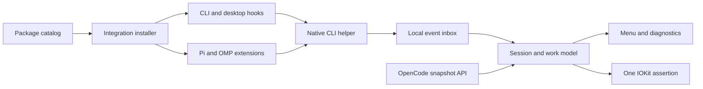

# AwakeLite architecture

Status: Stage 1 core (activity model and local event store) implemented in `Sources/Core/`, and Stage 2 catalog, installer, activation, and catalog window implemented in `Sources/Integrations/` and `Sources/IntegrationsView.swift`. Still proposed: vendor adapters, the helper executable, power/UI wiring, and Stage 5 startup. Requirements are in [SPEC.md](SPEC.md). Verification status lives in [STATE.md](STATE.md). Source research is in [HARNESS_RESEARCH.md](HARNESS_RESEARCH.md).

## User flow

The user opens the catalog, installs support for one family, and completes any hook-trust steps in that harness. An available local source then reports work state. AwakeLite combines states and owns one sleep assertion. Removing a package stops its contribution and removes only app-owned connections. The model accepts events only from enabled packages whose activation generation matches.

When connecting to an already running agent, use a snapshot only if an authoritative API exists. Otherwise, explain that a new request is needed. An open program alone never becomes Working.

## Selected structure

The menu-bar app owns the activity model, aggregation, and IOKit. The native CLI helper accepts and validates events. It neither holds an assertion nor stays alive as a background service.



This structure needs no network service, separate daemon, or remote marketplace. The OpenCode connection is a client of an existing local service, not a new server.

## Alternatives considered

Two independent candidate architectures were compared and reviewed before implementation.

| Option | Benefits | Costs | Decision |
| --- | --- | --- | --- |
| Independent event files and an app-owned model | Events survive app downtime; the helper needs no running receiver; no extra daemon | Requires queue bounds, crash-safe checkpoints, and gap handling | Selected base |
| Unix socket with one helper service | Centralized writes and acknowledgments | Adds service lifecycle, reconnect, and storage during outages | Excluded from the first version |
| One mutable JSON file for all helpers | Few files | Concurrent writes can lose updates and require shared synchronization | Rejected |
| Process presence or CPU usage | Easy connection | Cannot distinguish work from an open conversation | Rejected as automatic activity evidence |

Keep short helper operations and an explicit message format from the socket candidate. Arrival order in a socket or file does not prove causal order inside a harness.

## Module ownership

The following groups define ownership. Activity and the local event store are implemented in `Sources/Core/`; the remaining new source files and adapter tests do not exist yet.

| Module | Owns | Must not own |
| --- | --- | --- |
| App and views | MenuBarExtra, integration window, error presentation | Vendor payload parsing or causal-order decisions |
| Activity (`Sources/Core/Activity.swift`) | Work identity, transitions, deduplication, snapshots, aggregate decision | IOKit calls or harness configuration changes |
| Local event store (`Sources/Core/LocalEventStore.swift`) | Inbox, checkpoints, recovery, limits, safe file access | Declaring work complete because a file is old |
| Native helper | Bounded hook parsing and normalized event writes | Raw payload persistence, GUI startup, or inference |
| Integrations | Catalog, compatibility targets, previews, install and removal | Declaring a mode verified because its executable exists |
| Adapters | Vendor events, source-specific limitations, snapshot APIs | Guessing missing data or writing directly to IOKit |
| Power | One assertion and actual acquisition/release results | Process polling, pmset changes, or lid control |

Retain the existing app entry point, controller, and login-item code where appropriate. Keep Activity and the event store in the `Sources/Core/` group; add compact source groups for Integrations and Adapters, plus a separate helper entry point. [AGENTS.md](AGENTS.md) maps existing files and proposed destinations. These groups are responsibilities, not a requirement for separate frameworks or one file per type.

`ProcessScanner` must stop determining sleep policy. Any owner-identity check is separate from activity detection. Exact new file boundaries can be refined during an approved implementation.

## Data model

| Entity | Main fields | Invariant |
| --- | --- | --- |
| Integration package | Family, package version, assets, install steps, compatibility targets | One catalog drives the UI, installer, and fixtures |
| Compatibility target | CLI or desktop, harness version, observation capabilities, verification level | Verification of one target does not transfer to another |
| Owner identity | PID, start time, UID, OS boot identity, instance identity | A PID alone is insufficient |
| Session identity | Family, instance, opaque session ID | Identical strings from different sources do not merge sessions |
| Work identity | Session, generation, child or background-work ID | Old completion cannot close new work |
| Activity event | Schema version, event ID, source, activation generation, target, work, transition, available causal data | Fields without a reliable source remain unknown |
| Session state | Observed work, waits, terminal facts, observation completeness | Waiting in one work item does not cancel another |
| Install receipt | Package, activation generation, owned entries, hashes, operation stage | Removal is limited to app-owned changes |

Owner identity names the observed agent instance, not the short-lived hook helper process; adapters must derive a stable identity for that instance and change it on restart or PID reuse.

Normalized transitions cover start, human wait, resume, completion, error, cancellation, child-work start and end, snapshot, observation loss, work-scoped heartbeat, and owner termination. A heartbeat confirms observer liveness for one work item. It does not establish work state and provides no session-level liveness. Owner termination retires only that owner's work after identity verification.

Derive the sleep decision from the model instead of storing a second independent decision flag. User pause suppresses the system effect without changing observed work.

## Event order and uncertainty

Stale updates lose: an event older than the stored record for that work is rejected. Ownership is positional: the owner instance must equal the session instance, and a conflicting snapshot owner marks the record uncertain rather than transferring it. Events dated more than 300 s in the future are rejected at ingest with a gap, using event time or inbox file time as the gap timestamp.

Snapshots carry a completeness flag. Only a complete snapshot is authoritative for its scope: omitted active work ends. An incomplete snapshot marks omitted work uncertain. A snapshot older than a record or a covering gap neither ends work nor clears that gap. Oversize snapshots that exceed the work bound are rejected with a capacity gap, which conservatively marks affected work uncertain.

## Storage without an unbounded journal

A private user directory contains installed package resources and receipts, independent event files, a model checkpoint, and a short installation-operation journal. Restrict access to the current user. Never use unchecked identifiers as path components.

Bound the inbox, event size, work count, and retained terminal facts. On overflow, persist an observation-gap marker scoped to the affected source, instance, and known sessions; rejection and overflow gaps are instance-scoped, observer-loss gaps stay session-scoped. Gap storage has an absolute bound: collapse the densest scope first, then merge the two oldest. Do not claim confirmed idle until a complete authoritative snapshot covers that scope, or all affected work and owners are confirmed terminated. An unrelated new task cannot clear the uncertainty. Never delete old events merely because they appear unnecessary.

Checkpoint envelope: the checkpoint file stores a versioned `{schema, model}` envelope with strict required keys. Corrupt, oversize, symlink, or unsupported-schema checkpoints refuse to load rather than starting idle. One process serializes reconcile with an exclusive lock on `root/.lock`; the checkpoint is written with full fsync plus atomic rename.

Inbox writes use canonical identifiers and bounded payloads, with link-based exclusive file creation so concurrent writers cannot overwrite each other. Rejected files quarantine without overwriting. Save before move: processed inbox files are deleted and rejected files quarantined only after the checkpoint is saved, so a crash replays rather than loses facts.

A directory watcher requests inbox reconciliation. The app also reads the inbox at startup and periodically reconciles the inbox and owners of enabled integrations. This periodic pass must find events even when every watcher notification is lost and the owner remains alive. With no integrations enabled, do not run periodic inbox polling. File notifications alone are insufficient.

## Packages and connections

Seven bundled manifests describe trusted operations for known adapters. Installation copies or registers resources only for the selected family. Uninstalled packages create no hooks, timers, or connections.

| Family | Preferred mechanism | Separate verification needed |
| --- | --- | --- |
| Claude Code | User-level lifecycle hooks | Desktop Code, waits, errors, and Stop rejected by another hook |
| Codex | User-level hooks; snapshots from an accessible app-server if needed | Hook trust, normal desktop chats, local versus cloud orchestration |
| Cursor | Native Agent hooks | Cancellation, automatic continuation, background subagents |
| Antigravity | Hooks that account for fullyIdle | Exact CLI and desktop versions, background work, human waits |
| Pi | In-process extension | Reload, session switch, cancellation, generation IDs |
| OMP | Separate in-process extension | Auto-retry, continuation queues, background work |
| OpenCode | Native read-only connector to the existing service | Version, identity, execution details, permissions, forms |

Vendor event names and paths belong to a versioned adapter, not the shared core. Verify them against the owning source before implementation.

OpenCode needs an additional check: presence in `/api/session/active` is insufficient evidence of work. Read execution details and human waits. Use authorization only against the verified local endpoint. Do not restart the service to connect.

## Installation and removal

Create a preview and read current configuration before a change. Structurally add only owned entries with a stable marker. Reject unsupported formats, symlinks, conflicts, and stale previews without losing unrelated data.

Installation stages are prepared, applying, committed, and recovery-required. A receipt records ownership and completed changes. Rollback checks expected hashes so it cannot overwrite later user edits.

A package can connect several compatibility targets without duplicating shared hooks. Each installation receives a new activation generation, recorded in its receipt and installed command or extension. An old observer cannot acquire the new generation by reading the current receipt when it emits an event. Removing support excludes the package from the model. Ignore old-hook events even after reinstall with a different generation.

Support non-default configuration roots, profiles, and XDG locations explicitly, or report the limitation. Do not silently write into an unused default profile.

Do not bypass Codex hook trust or workspace policy. The hook helper must not change permission decisions, continue tasks, or add model context. Its output must be inert according to the specific harness contract.

## Catalog, manifests, and installer contracts

Stage 2 owns one catalog, one install model, one recovery path, and one activation handoff. Three units exist in `Sources/Integrations/`, compiled by both `swift test` and `./build.sh`: 2.1 (catalog, manifest loader, product discovery), 2.2 (installer core), and 2.4 (activation generation and privacy). The catalog window (2.3) is separate UI code and adds no file editing. Vendor paths and vendor event names stay in adapter sources, never in these shared types. Nothing here parses a vendor payload, holds power policy, touches IOKit, or runs a subprocess.

Stage 2 installs **inert marker-bearing templates**: a JSON value under an app-owned key, a comment-delimited block, or an app-owned copied file. It does not claim those templates are wired to a harness. Vendor-accurate hook wiring is Stage 3; a manifest schema bump is acceptable then.

### App-owned storage layout

Everything the app owns lives under one injected root (production default `~/Library/Application Support/AwakeLite/`):

```
<app-support-root>/
├── inbox/                                  # Stage 1: immutable normalized event files
├── rejected/                               # Stage 1: quarantined event files
├── checkpoint.json                         # Stage 1: model checkpoint envelope
├── .lock                                   # Stage 1: single-writer lock
├── packages/<family>/                      # immutable copy of the bundled family directory
├── receipts/<family>.json                  # one receipt per installed package
└── journal/<operation-id>.json             # one in-flight or unresolved operation
    └── backups/<operation-id>/<index>      # app-owned package directory only
```

Directories are created with mode 0700 and files with 0600. An existing file keeps its permission bits when the installer rewrites it, so editing a user's configuration is never a silent permission change. `<family>` matches a single canonical path component (`[A-Za-z0-9._-]`, no separators). `<operation-id>` is `<20-digit unix micros>-<16 hex>`, so the journal file name is both chronological and unpredictable, and it must equal the `operationId` inside the file.

The package directory holds a copy of `<bundle>/Resources/Integrations/<family>/` (manifest plus assets), so an app update cannot change installed support underneath a running harness. Removal deletes it because the install created it. No user configuration file is ever copied into app storage: rollback uses app-owned template content only (see "Operation journal").

### Package manifest (bundled, trusted, schema 1)

`Resources/Integrations/<family>/manifest.json` is trusted input shipped inside the app. It is declarative: no key can express a shell command, network address, executable, or code. Unknown keys anywhere in the document are refused, which is what keeps such a field out.

| Field | Meaning |
| --- | --- |
| `schema` | Exactly `1`. Other values are refused. |
| `family` | Canonical family identifier; must equal the containing directory name. |
| `displayName` | Card title; non-empty. |
| `packageVersion` | Version of this bundled resource set; non-empty. |
| `targets[]` | `id`, `mode` (`cli`, `desktop`), `capabilities` (subset of `lifecycleHooks`, `snapshotAPI`, `inProcessExtension`, `readOnlyConnector`), `verificationLevel` (`unverified`, `fixture`, `live`). |
| `assets[]` | `id`, `source` (relative path inside the family directory), `destination` (relative to the installed package root). |
| `steps[]` | Declarative steps, described below. |
| `requiresRestart` | Whether the harness must restart before support can take effect. |
| `requiresHookTrust` | Whether the harness requires a user trust action. |
| `notes` | Limitations shown before confirmation. |

Validation performed by `PackageManifestReader`, each failure naming `<family>/manifest.json` and the offending field:

- `schema` exactly 1; `family` equals the directory name; `displayName` and `packageVersion` non-empty; unknown top-level keys refused.
- `targets[]` non-empty, ids unique and equal to `"<family>.<suffix>"` with one safe suffix; `mode`, `capabilities`, and `verificationLevel` from their closed sets; unknown target keys refused. No per-family target list is hardcoded: the ten-target total is asserted by tests (`claude-code.cli`, `claude-code.desktop`, `codex.cli`, `codex.desktop`, `cursor.desktop`, `antigravity.cli`, `antigravity.desktop`, `pi.cli`, `omp.cli`, `opencode.tui`).
- `assets[]` ids unique; `source` is a safe relative path inside the family directory, resolves to an existing regular file, and no component from the family directory down is a symlink; `destination` is a safe relative path, unique across assets. Absolute paths, `..`, empty components, and escapes are refused. Asset text is scanned for placeholder tokens: an unknown `{token}` is a load error rather than something that ships verbatim.
- `steps[]` non-empty; `kind` in `hookConfig`, `pluginFile`, `extensionFile`, `commandWrapper`; `format` in `json`, `toml`, `yaml`, `text`, `directory`; `target` exists in `targets[]`; owned-entry markers non-empty, single-line, and unique across the whole catalog; each owned entry names an existing asset.
- `configRoot` must be exactly `${APPSUPPORT}`, or start with `~/` or `$HOME/` and name a safe relative subpath. `path` is a safe relative path below that root. `keyPath` is a non-empty array of non-empty strings and is permitted only for `format: json` (required for a JSON `hookConfig` step).

`verificationLevel` is data, never inference: discovering an executable, an app bundle, or a running process leaves it unchanged. Only a fixture or a recorded live check raises it.

### Installed entry mechanics

Every installed asset text is rendered once at apply time. Allowed placeholders are `{helperPath}`, `{family}`, `{target}`, `{generation}`, and `{marker}`. `helperPath` is the documented constant `/Applications/AwakeLite.app/Contents/MacOS/AwakeLiteHelper`; Stage 3 ships the executable. Substituted values are escaped for the double-quoted context every bundled template uses, and JSON assets are rendered structurally so the result stays valid JSON. The repo's literal placeholder text must not appear in any installed file, which tests assert.

- **`hookConfig` + `json`.** The file is read and parsed. The installer walks `keyPath`, creates missing intermediate objects, and writes `container[marker] = assetValue`. Every foreign key and value is preserved. Malformed JSON, a non-object path segment, or a foreign value already at the marker is a conflict: the file is left byte-identical. The file is written atomically and structurally (sorted keys, two-space indentation), which is the most a structural JSON writer preserves.
- **`hookConfig` + `toml`/`yaml`/`text`.** A marker-delimited block is appended or replaced:
  `# >>> awake-lite BEGIN <marker> generation=<n>` … `# <<< awake-lite END <marker>`.
  Bytes outside the block are never rewritten. An identical block makes reinstall idempotent; two blocks for one marker, or a BEGIN without its END, is a conflict. When the existing file does not end with a newline, one is appended before the block; removal deletes exactly the block, including its final newline, and does not remove that separator.
- **`pluginFile`/`extensionFile`/`commandWrapper`, and `format: directory`.** The rendered asset is written to `configRoot/path` (for `directory`, the asset file name is appended to the app-owned directory). A destination that exists with foreign content is a conflict; the destination and its content marker are recorded in the receipt.
- **Refusals.** Unsupported kind/format combinations (for example `hookConfig` with `directory`), unknown kinds or formats, a symlink anywhere on the edited path, a conflicting existing entry, and malformed input all fail with an explanation naming the path. A whole foreign file is never replaced.
- **Removal.** Only receipt entries are undone, in reverse order of kind: the marker key (pruning containers it leaves empty), the marker block, or the app-owned file. A file the install created is deleted once it holds nothing else. Any entry whose current content no longer matches the receipt hash is reported as a conflict and left untouched; the receipt stays for a later retry.
- **Temporary files.** An atomic write first sweeps abandoned `.awake-lite-*.tmp` files older than an hour from the destination directory.

### Install receipt (schema 1)

`receipts/<family>.json` records ownership and lifecycle only:

| Field | Meaning |
| --- | --- |
| `schema` | Exactly `1`. |
| `family` | Family identifier; must match the file name. |
| `packageVersion` | Version that produced the installed entries. |
| `activationGeneration` | `UInt64`, new for every install and reinstall. |
| `installedAt` | Timestamp of the commit. |
| `stage` | `committed`. |
| `entries[]` | `target`, `path`, `format`, `kind`, `marker`, `expectedHash`, `keyPath`, `createdFile`. |
| `previousGeneration` | Optional; the generation this install replaced. |
| `createdDirectories` | Directories the install created; removal deletes only these, and only when empty. |

`entries[]` is the complete removal set: an entry not listed is never touched. `expectedHash` is the hash of the marker value (canonical JSON), the block body, or the copied file. `createdFile` is the only authority for deleting a file. A receipt contains no prompts, responses, tool arguments, payloads, or credentials.

### Operation journal (schema 1)

`journal/<operation-id>.json` exists only while an operation is in flight or unresolved:

| Field | Meaning |
| --- | --- |
| `schema` | Exactly `1`. |
| `operationId` | Must equal the file name stem. |
| `family`, `action` | Package and `install`/`remove`. |
| `stage` | `prepared`, `applying`, `committed`, `recoveryRequired`. |
| `startedAt` | Operation start. |
| `expectedMutations` | How many configuration mutations the operation intends to record. |
| `steps[]` | `operation` (`config`, `obsolete`, `package`), `target`, `path`, `beforeHash`, `afterHash`, `backupPath` (package directory only), `applied`, `created`, `undo`. |
| `createdPaths[]` | Directories the operation created and must delete on rollback. |
| `receipt` | The complete receipt to write when the mutation set finishes. |

`undo` is an app-owned instruction (`removeJSONEntries`, `restoreJSONEntries`, `removeBlocks`, `restoreBlocks`, `deleteFile`, `restoreFile`) whose payload is rendered template text or a removed marker value. A shared configuration file is never copied into the journal, so no user content enters app storage. Each step is registered before its mutation and completed after it, and undo instructions are idempotent, so an interruption at any point is reversible.

Recovery runs at app start and before any new operation. It completes the operation forward when every step is applied, every path still holds the recorded result, and the expected mutation count was recorded; otherwise it rolls back to `prepared` and removes created paths. Only the last step that touched a path is compared, because a later step in the same file supersedes an earlier one. Rollback refuses to overwrite a file whose current hash differs from the step's recorded result — a later user edit — sets the stage to `recoveryRequired`, and reports the conflict; a new operation is then refused until it is resolved.

### Module and API boundaries

| File | Public surface | Boundary |
| --- | --- | --- |
| `Sources/Integrations/Manifest.swift` | `JSONValue`, `Digests`, `PathRules`, `ConfigRootSpec`, manifest types, `PackageManifestReader`, `ManifestError` | Strict schema-1 decoding and path rules only. |
| `Sources/Integrations/Catalog.swift` | `Catalog`, `CatalogError`, `TargetStatus`, `ProductDiscovery` | Loads the seven manifests, enforces cross-manifest marker and target uniqueness, resolves local availability. |
| `Sources/Integrations/ConfigEditor.swift` | `FileState`, `ConfigEditor`, `JSONMutation`, `MarkerBlock`, `Template`, `IntegrationPaths` | Atomic writes, symlink refusal, structural JSON edits, marker blocks. No vendor knowledge. |
| `Sources/Integrations/InstallPlan.swift` | `InstallStage`, `InstalledEntry`, `InstallReceipt`, `JournalStep`, `JournalUndo`, `OperationJournal`, `InstallPlan`, `InstallPreview`, `InstallPlanner` | Declarative plan and preview construction; reads only. |
| `Sources/Integrations/Installer.swift` | `Installer` with `preview(family:configRoot:appSupportRoot:discovery:)`, `apply(_:now:)`, `remove(family:appSupportRoot:now:)`, `recoverPending(appSupportRoot:)`; `InstallerStorage`; `InstallerError` | Owns previews, edits, receipts, journal, rollback, recovery. |
| `Sources/Integrations/Activation.swift` | `ActivationHandoff` with `readState()`, `apply(to:)`, `revoke(family:in:)`; `ActivationState`, `ActiveFamily`, `UnresolvedOperation` | Reads committed receipts and journals and activates or deactivates the Stage 1 model. No observer, timer, event write, or power policy. |
| `Sources/IntegrationsView.swift` | `IntegrationsStore`, `IntegrationsWindowController`, `IntegrationsView`, preview/removal sheets | Seven cards, Installer-only actions, preview restating exact paths and owned entries; no vendor parsing, no power policy, no event writes. |

`preview` returns the family, display name, package version, generation it would create, previous generation, the injected roots, resolved target ids, declared target status (mode, capabilities, verification level, availability), preview entries with an action (`create`, `update`, `unchanged`, `conflict`), exact paths, notes, warnings, conflicts, and a digest of every input. It writes nothing. `apply` refuses a preview whose input files, receipt generation, or plan digest changed, and refuses any preview that carries a conflict.

`Catalog` resolves target availability from local files only: a documented candidate table of home-relative executables and application bundles, resolved against an injected home root and injected application roots. Discovery never launches a product, never runs a subprocess, and never changes a verification level.

### Activation-generation handoff

`Sources/Integrations/Activation.swift` is the only place where install state meets the model. It reads `receipts/*.json` and `journal/*.json` under an injected app-support root and produces:

```
struct ActivationState {
    var active: [ActiveFamily]        // family + activated generation
    var inactive: [String]            // known families that must not be observed
    var unresolved: [UnresolvedOperation]  // family + operation id + stage
}
```

- `active` holds one entry per committed receipt whose family has no unfinished operation.
- `inactive` holds families storage knows about that must not be observed, including every family with a `prepared`, `applying`, or `recoveryRequired` journal.
- `unresolved` reports each journal that has not reached `committed`, with its stage.

API:

| Call | Meaning |
| --- | --- |
| `ActivationHandoff(appSupportRoot:)` | Injected root; production passes `~/Library/Application Support/AwakeLite`. |
| `readState() throws -> ActivationState` | Reads receipts and journals only. |
| `apply(to: &model) throws -> ActivationState` | Startup handoff. Deactivates every family that is active in the model without a committed receipt, then calls `activate(family:generation:)` for each active family. |
| `revoke(family:in: &model) throws -> ActivationState` | Removal handoff. Refuses while a committed receipt still exists, then calls `deactivate(family:)`, dropping that family's work and gaps. |

A reinstall issues `previousGeneration + 1` (1 for a fresh install), recorded in the receipt and rendered into the installed template. Because `ActivityModel.activate` deactivates on a generation change, a reinstall drops work from the old installation, and an event carrying any other generation is rejected as `staleActivation` — including a late event from a hook that was running during removal or an earlier reinstall. A family with no committed receipt is inactive: its events are rejected as `inactiveSource` and it registers no work, gap, or dedup entry.

An unresolved operation never activates its family, so a half-installed package cannot receive events and `recoveryRequired` cannot activate while its conflict stands. `recoveryRequired` must be resolved first; after recovery the next handoff activates the surviving committed generation.

The handoff is read-only: no observer, timer, subprocess, event file, power decision, or receipt write. Startup order at Stage 5 is `recoverPending()` → `ActivationHandoff.apply(to:)` → inbox reconciliation. The model is still not wired to power policy in Stage 2.

### Config-root rules

- `configRoot` passed to `preview` is the injected home root (a temporary directory in tests); `~` and `$HOME` selectors resolve against it, and `${APPSUPPORT}` resolves to the injected app support root.
- A step never guesses among several candidate roots. If the intended root is not explicitly identified, the installer reports the limitation instead of writing to an unused default profile and implying success.
- Every path the installer writes lies inside an injected root. Anything else fails validation.
- Read current content, structurally add or remove only owned entries, and preserve foreign settings, hooks, plugins, credentials, and formatting intent.
- Unsupported formats, symlink targets, and conflicting existing entries fail with an explanation rather than replacing a file.

### Stage 2 test matrix

All checks run against a temporary home, configuration, and app-support root; no real user settings are read or written.

1. Fresh install for each of the seven families.
2. Repeated install is idempotent and creates no duplicate entry.
3. Install beside foreign hooks and plugins preserves them.
4. Unsupported format or a conflicting entry fails without replacing the file.
5. A symlink target is refused.
6. A stale preview is refused.
7. Interruption after each journal step; recovery reaches committed or prepared on the next start.
8. Rollback over a user-edited file is refused and reported as recoverable.
9. Removal preserves foreign entries.
10. Removal or reinstall rejects old-generation events.
11. Receipts and journals contain no conversation data (A15).
12. No observer runs for an inactive package (A01).

Items 1–9 and 11 are implemented in `Tests/AwakeLiteCoreTests/InstallerTests.swift`; item 11 additionally covers the key allowlists and error text in `PrivacyTests.swift`. Item 10 (old-generation rejection after removal and after reinstall, including a late event) and item 12 (a family with no committed receipt observes nothing, and unresolved journals never activate) are implemented in `ActivationTests.swift` against the model. Live observer wiring remains Stage 3.

## Checks before adapter implementation

First prove the core with fixtures for two parallel sessions, late completion, a waiting parent with a working child, an event gap, PID reuse, and restart.

Then verify installation in an isolated home directory with unrelated hooks, failures, non-default paths, and interruption during changes. Connect available real products only afterward. Fixture success does not raise live compatibility status.

## Approval record and remaining first-phase checks

Approved on 2026-11-01 for Stage 1: native app-owned core, local packages, independent events, separate compatibility targets, and uncertainty rules.

Remaining first-phase checks: bounded checkpoint prototype verification, event completeness in installed harnesses, and actual observation of local Codex desktop tasks. If a source lacks the required guarantees, revise that adapter or its status rather than weaken the shared model.
