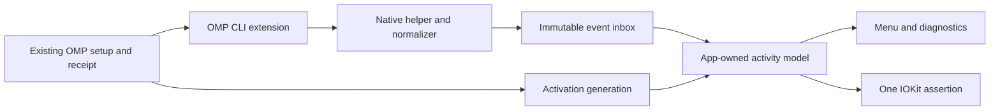

# AwakeLite architecture

Updated: 2026-11-02. The active first-version target is OMP CLI. [SPEC.md](SPEC.md) owns behavior; [ROADMAP.md](ROADMAP.md) R1–R4 owns work order; [STATE.md](STATE.md) owns evidence. References to former Stages 1–5 below identify existing contracts and historical work, not a requirement to finish every family.

## First-version path

Reuse the existing OMP extension, helper, normalizer, local event store, activity model, and power boundary. The app owns startup, reconciliation, owner validation, and decision delivery. It is the only checkpoint writer and assertion owner.



This is the target path, not a claim that the app already connects it. The old process scanner is deleted in the worktree. `PowerPolicy` exists, but `AwakeController` starts idle and receives no model updates. App startup and observer coordination remain to be implemented in R1.

Use the existing installer and receipt path for the OMP proof. Keep non-OMP families outside the first-version runtime contribution, including any restored model state, without removing their real settings. A later manual setup design must explain valid activation and removal; it cannot bypass the helper's generation checks.

Startup must recover pending installation operations, load the persisted model, validate activation and owners, reconcile the inbox, and deliver the aggregate decision. Unreadable state must not silently become confirmed idle. Use one app-owned coordinator, adding only the code needed to connect existing boundaries.

R1 proves synthetic OMP metadata through the production helper and app to real IOKit. R2 immediately checks a real OMP session. R3 closes recovery and storage gaps. A new event transport, generic observer framework, or installer rewrite is not needed to begin this proof.

## Preserved broader contracts

The rest of this document describes existing shared code and the former multi-family design. Seven bundled families and ten manifest targets remain an inventory, not first-version acceptance requirements. Other-family adapters, OpenCode polling, and catalog expansion are deferred. Retained code must still obey privacy, generation, ownership, and recovery contracts.

## Alternatives considered

Two independent candidate architectures were compared and reviewed before implementation.

| Option | Benefits | Costs | Decision |
| --- | --- | --- | --- |
| Independent event files and an app-owned model | Events survive app downtime; the helper needs no running receiver; no extra daemon | Requires queue bounds, crash-safe checkpoints, and gap handling | Selected base |
| Unix socket with one helper service | Centralized writes and acknowledgments | Adds service lifecycle, reconnect, and storage during outages | Excluded from the first version |
| One mutable JSON file for all helpers | Few files | Concurrent writes can lose updates and require shared synchronization | Rejected |
| Process presence or CPU usage | Easy connection | Cannot distinguish work from an open conversation | Rejected as automatic activity evidence |

Keep short helper operations and an explicit message format from the socket candidate. Arrival order in a socket or file does not prove causal order inside a harness.

## Module ownership

The following groups define ownership. Activity and the local event store are implemented in `Sources/Core/`; the catalog, installer, and activation handoff in `Sources/Integrations/`; the hook normalizer in `Sources/HookNormalizer.swift`; the family adapters in `Sources/Adapters/`; the helper process shell in `Helper/main.swift`. `Sources/PowerAssertion.swift` now owns the power boundary. The observer scheduler and app-to-model connection are still missing.

| Module | Owns | Must not own |
| --- | --- | --- |
| App and views (`Sources/*.swift`) | MenuBarExtra, integration window, error presentation | Vendor payload parsing or causal-order decisions |
| Activity (`Sources/Core/Activity.swift`) | Work identity, transitions, deduplication, snapshots, aggregate decision | IOKit calls or harness configuration changes |
| Local event store (`Sources/Core/LocalEventStore.swift`) | Inbox, checkpoints, recovery, limits, safe file access | Declaring work complete because a file is old |
| Hook normalizer (`Sources/HookNormalizer.swift`) | Payload allowlist, adapter registry, activation check, invariant re-stamp, one event write | Reading undocumented fields, persisting payload bytes, or deciding power |
| Native helper (`Helper/main.swift`, `Sources/Adapters/HelperRunner.swift`) | Argument and stdin bounds, exit codes, one event write per emission | Raw payload persistence, GUI startup, timers, network, or inference |
| Owner identity (`Sources/Adapters/OwnerIdentity.swift`) | Ancestry walk, wrapper skipping, instance token, unmeasured fallback | Deciding activity or retiring work by itself |
| Integrations (`Sources/Integrations/`) | Catalog, compatibility targets, previews, install and removal, activation handoff | Declaring a mode verified because its executable exists |
| Adapters (`Sources/Adapters/`) | Vendor event names, documented payload shapes, source-specific limitations, OpenCode read-only reads | Guessing missing data, storing state, or writing directly to IOKit |
| Power (`Sources/PowerAssertion.swift`, exists but disconnected) | One assertion and actual acquisition/release results | Process polling, pmset changes, or lid control |

Retain the existing app entry point, controller, and login-item code where appropriate. Activity and the event store stay in `Sources/Core/`; Integrations and Adapters are compact source groups and the helper is a separate entry point compiled into its own binary. [AGENTS.md](AGENTS.md) maps actual files. These groups are responsibilities, not a requirement for separate frameworks or one file per type.

`ProcessScanner.swift` is deleted in the current worktree. Process presence must not return as activity evidence. Owner-identity checks remain separate from activity detection.

## Data model

| Entity | Main fields | Invariant |
| --- | --- | --- |
| Integration package | Family, package version, assets, install steps, compatibility targets | One catalog drives the UI, installer, and fixtures |
| Compatibility target | CLI or desktop, harness version, observation capabilities, verification level | Verification of one target does not transfer to another |
| Owner identity | PID, start time, UID, OS boot identity, instance identity | A PID alone is insufficient |
| Session identity | Family, instance, opaque session ID | Identical strings from different sources do not merge sessions |
| Work identity | Session, generation, child or background-work ID | Old completion cannot close new work |
| Activity event | Schema version, event ID, source, activation generation, target, work, transition, available causal data | Fields without a reliable source remain unknown |
| Session state | Observed work, waits, terminal facts, observation completeness | Waiting in one work item does not cancel another |
| Install receipt | Package, activation generation, owned entries, hashes, operation stage | Removal is limited to app-owned changes |

Owner identity names the observed agent instance, not the short-lived hook helper process; adapters must derive a stable identity for that instance and change it on restart or PID reuse. A caller-supplied owner (the Pi and OMP extensions) mints its instance token once per harness process, so a different process on a reused pid is a different owner; it carries `startTimeMicros 0` by contract, so a liveness probe cannot confirm that a live pid still names the recorded owner. That is deliberate, because a measurable identity would be lost when the detached helper is orphaned.

Normalized transitions cover start, human wait, resume, completion, error, cancellation, child-work start and end, snapshot, observation loss, work-scoped heartbeat, and owner termination. A heartbeat confirms observer liveness for one work item. It does not establish work state and provides no session-level liveness. Owner termination retires only that owner's work after identity verification, and only records whose `updatedAt` is not newer than the event, so a late termination cannot end work observed after it; it never rewinds a record's `updatedAt`.

Derive the sleep decision from the model instead of storing a second independent decision flag. User pause suppresses the system effect without changing observed work.

## Event order and uncertainty

Stale updates lose: an event older than the stored record for that work is rejected. Ownership is positional: the owner instance must equal the session instance, and a conflicting snapshot owner marks the record uncertain rather than transferring it. Events dated more than 300 s in the future are rejected at ingest with a gap, using event time or inbox file time as the gap timestamp.

Snapshots carry a completeness flag. Only a complete snapshot is authoritative for its scope: omitted active work ends. An incomplete snapshot marks omitted work uncertain. A snapshot older than a record or a covering gap neither ends work nor clears that gap. Oversize snapshots that exceed the work bound are rejected with a capacity gap, which conservatively marks affected work uncertain.

## Storage without an unbounded journal

A private user directory contains installed package resources and receipts, independent event files, a model checkpoint, and a short installation-operation journal. Restrict access to the current user. Never use unchecked identifiers as path components.

Bound the inbox, event size, work count, and retained terminal facts. On overflow, persist an observation-gap marker scoped to the affected source, instance, and known sessions; rejection and overflow gaps are instance-scoped, observer-loss gaps stay session-scoped. Gap storage has an absolute bound: collapse the densest scope first, then merge the two oldest. Do not claim confirmed idle until a complete authoritative snapshot covers that scope, or all affected work and owners are confirmed terminated. An unrelated new task cannot clear the uncertainty. Never delete old events merely because they appear unnecessary.

Checkpoint envelope: the checkpoint file stores a versioned `{schema, model}` envelope with strict required keys. Corrupt, oversize, symlink, or unsupported-schema checkpoints refuse to load rather than starting idle. One process serializes reconcile with an exclusive lock on `root/.lock`; the checkpoint is written with full fsync plus atomic rename.

Inbox writes use canonical identifiers and bounded payloads, with link-based exclusive file creation so concurrent writers cannot overwrite each other. An event name that already exists is compared byte-for-byte: identical content is the same normalized event arriving twice (a retry, or two producers of one fact), so it is an idempotent replay that succeeds and adds no file; different content under the same name would silently merge two facts, so it is refused as `writeFailed`. Rejected files quarantine without overwriting. Save before move: processed inbox files are deleted and rejected files quarantined only after the checkpoint is saved, so a crash replays rather than loses facts.

Limitation (recorded as review finding M5 and deferred): `enqueue` does not enforce the 2048-file inbox cap. A burst of events while the app is not running is therefore detected only when reconciliation next runs, and the `storageOverflow` gap it records clears only by removal or reinstall. R3 must enforce the bound before a burst accumulates, including while the app is stopped. Drain cadence alone cannot bound stopped-app production.

A directory watcher requests inbox reconciliation. The app also reads the inbox at startup and periodically reconciles the inbox and owners of enabled integrations. This periodic pass must find events even when every watcher notification is lost and the owner remains alive. With no integrations enabled, do not run periodic inbox polling. File notifications alone are insufficient.

## Packages and connections

Seven bundled manifests describe the preserved package inventory. Only OMP CLI is in active first-version scope. Installation copies or registers resources only for the selected family. Uninstalled packages create no hooks, timers, or connections.

| Family | Preferred mechanism | Separate verification needed |
| --- | --- | --- |
| Claude Code | User-level lifecycle hooks | Desktop Code, waits, errors, and Stop rejected by another hook |
| Codex | User-level hooks; snapshots from an accessible app-server if needed | Hook trust, normal desktop chats, local versus cloud orchestration |
| Cursor | Native Agent hooks | Cancellation, automatic continuation, background subagents |
| Antigravity | Hooks that account for fullyIdle | Exact CLI and desktop versions, background work, human waits |
| Pi | In-process extension | Reload, session switch, cancellation, generation IDs |
| OMP | Separate in-process extension | Auto-retry, continuation queues, background work |
| OpenCode | Native read-only connector to the existing service | Version, identity, execution details, permissions, forms |

Vendor event names and paths belong to a versioned adapter, not the shared core. Verify them against the owning source before implementation.

OpenCode needs an additional check: presence in `/api/session/active` is insufficient evidence of work. Read execution details and human waits. Use authorization only against the verified local endpoint. Do not restart the service to connect.

## Installation and removal

Create a preview and read current configuration before a change. Structurally add only owned entries with a stable marker. Reject unsupported formats, symlinks, conflicts, and stale previews without losing unrelated data.

Installation stages are prepared, applying, committed, and recovery-required. A receipt records ownership and completed changes. Rollback checks expected hashes so it cannot overwrite later user edits.

A package can connect several compatibility targets without duplicating shared hooks. Each installation receives a new activation generation, recorded in its receipt and installed command or extension. An old observer cannot acquire the new generation by reading the current receipt when it emits an event. Removing support excludes the package from the model. Ignore old-hook events even after reinstall with a different generation.

Support non-default configuration roots, profiles, and XDG locations explicitly, or report the limitation. Do not silently write into an unused default profile.

Do not bypass Codex hook trust or workspace policy. The hook helper must not change permission decisions, continue tasks, or add model context. Its output must be inert according to the specific harness contract.

## Catalog, manifests, and installer contracts

Stage 2 owns one catalog, one install model, one recovery path, and one activation handoff. Three units exist in `Sources/Integrations/`, compiled by both `swift test` and `./build.sh`: 2.1 (catalog, manifest loader, product discovery), 2.2 (installer core), and 2.4 (activation generation and privacy). The catalog window (2.3) is separate UI code and adds no file editing. Vendor paths and vendor event names stay in adapter sources, never in these shared types. Nothing here parses a vendor payload, holds power policy, touches IOKit, or runs a subprocess.

Stage 2 introduced the install machinery: a JSON value under an app-owned key, a comment-delimited block, or an app-owned copied file, all rendered from bundled assets. Stage 3 then made the installed content functional for three families: Pi and OMP receive a real in-process extension, and Codex receives real inline hook tables. The OpenCode asset remains an inert marker/generation record because its connector is app-side. The install mechanics are unchanged, so no manifest schema bump was needed.

### App-owned storage layout

Everything the app owns lives under one injected root (production default `~/Library/Application Support/AwakeLite/`):

```
<app-support-root>/
├── inbox/                                  # Stage 1: immutable normalized event files
├── rejected/                               # Stage 1: quarantined event files
├── checkpoint.json                         # Stage 1: model checkpoint envelope
├── .lock                                   # Stage 1: single-writer lock
├── packages/<family>/                      # immutable copy of the bundled family directory
├── receipts/<family>.json                  # one receipt per installed package
└── journal/<operation-id>.json             # one in-flight or unresolved operation
    └── backups/<operation-id>/<index>      # app-owned package directory only
```

Directories are created with mode 0700 and files with 0600. An existing file keeps its permission bits when the installer rewrites it, so editing a user's configuration is never a silent permission change. `<family>` matches a single canonical path component (`[A-Za-z0-9._-]`, no separators). `<operation-id>` is `<20-digit unix micros>-<16 hex>`, so the journal file name is both chronological and unpredictable, and it must equal the `operationId` inside the file.

The package directory holds a copy of `<bundle>/Resources/Integrations/<family>/` (manifest plus assets), so an app update cannot change installed support underneath a running harness. Removal deletes it because the install created it. No user configuration file is ever copied into app storage: rollback uses app-owned template content only (see "Operation journal").

### Package manifest (bundled, trusted, schema 1)

`Resources/Integrations/<family>/manifest.json` is trusted input shipped inside the app. It is declarative: no key can express a shell command, network address, executable, or code. Unknown keys anywhere in the document are refused, which is what keeps such a field out.

| Field | Meaning |
| --- | --- |
| `schema` | Exactly `1`. Other values are refused. |
| `family` | Canonical family identifier; must equal the containing directory name. |
| `displayName` | Card title; non-empty. |
| `packageVersion` | Version of this bundled resource set; non-empty. |
| `targets[]` | `id`, `mode` (`cli`, `desktop`), `capabilities` (subset of `lifecycleHooks`, `snapshotAPI`, `inProcessExtension`, `readOnlyConnector`), `verificationLevel` (`unverified`, `fixture`, `live`). |
| `assets[]` | `id`, `source` (relative path inside the family directory), `destination` (relative to the installed package root). |
| `steps[]` | Declarative steps, described below. |
| `requiresRestart` | Whether the harness must restart before support can take effect. |
| `requiresHookTrust` | Whether the harness requires a user trust action. |
| `notes` | Limitations shown before confirmation. |

Validation performed by `PackageManifestReader`, each failure naming `<family>/manifest.json` and the offending field:

- `schema` exactly 1; `family` equals the directory name; `displayName` and `packageVersion` non-empty; unknown top-level keys refused.
- `targets[]` non-empty, ids unique and equal to `"<family>.<suffix>"` with one safe suffix; `mode`, `capabilities`, and `verificationLevel` from their closed sets; unknown target keys refused. No per-family target list is hardcoded: the ten-target total is asserted by tests (`claude-code.cli`, `claude-code.desktop`, `codex.cli`, `codex.desktop`, `cursor.desktop`, `antigravity.cli`, `antigravity.desktop`, `pi.cli`, `omp.cli`, `opencode.tui`).
- `assets[]` ids unique; `source` is a safe relative path inside the family directory, resolves to an existing regular file, and no component from the family directory down is a symlink; `destination` is a safe relative path, unique across assets. Absolute paths, `..`, empty components, and escapes are refused. Asset text is scanned for placeholder tokens: an unknown `{token}` is a load error rather than something that ships verbatim.
- `steps[]` non-empty; `kind` in `hookConfig`, `pluginFile`, `extensionFile`, `commandWrapper`; `format` in `json`, `toml`, `yaml`, `text`, `directory`; `target` exists in `targets[]`; owned-entry markers non-empty, single-line, and unique across the whole catalog; each owned entry names an existing asset.
- `configRoot` must be exactly `${APPSUPPORT}`, or start with `~/` or `$HOME/` and name a safe relative subpath. `path` is a safe relative path below that root. `keyPath` is a non-empty array of non-empty strings and is permitted only for `format: json` (required for a JSON `hookConfig` step).

`verificationLevel` is data, never inference: discovering an executable, an app bundle, or a running process leaves it unchanged. Only a fixture or a recorded live check raises it.

### Installed entry mechanics

Every installed asset text is rendered once at apply time in a single left-to-right pass: a substituted value is never scanned again, so a `{marker}` inside a substituted value cannot expand into a second placeholder. Allowed placeholders are `{helperPath}`, `{family}`, `{target}`, `{generation}`, and `{marker}`. `helperPath` is an injected Installer value recorded in the preview and checked again at apply. The catalog store resolves it from the running bundle through `HelperResolver` and refuses setup if resolution fails. The default Installer initializer retains `/Applications/AwakeLite.app/Contents/MacOS/AwakeLiteHelper` for callers that do not inject a path. The build places the helper inside `Contents/MacOS/` and signs it before the bundle. Every installed asset ignores helper exit status, so runtime delivery still needs a separate check. Substituted values are escaped for the double-quoted context every bundled template uses, and JSON assets are rendered structurally so the result stays valid JSON. The repo's literal placeholder text must not appear in any installed file, which tests assert.

Limitation (recorded as review finding M3 and deferred): the escape is for the TOML/JSON string context, not for the shell. The installed Codex command quotes `{helperPath}` for a TOML string, so a bundle path containing `"`, `$`, or a backtick is not supported. Resolving the current bundle path does not establish shell-safe rendering. Verify the chosen OMP bundle location in R1 and R2; the default path is not a requirement to install into `/Applications`.

- **`hookConfig` + `json`.** The file is read and parsed. The installer walks `keyPath`, creates missing intermediate objects, and writes `container[marker] = assetValue`. Every foreign key and value is preserved. Malformed JSON, a non-object path segment, or a foreign value already at the marker is a conflict: the file is left byte-identical. The file is written atomically and structurally (sorted keys, two-space indentation), which is the most a structural JSON writer preserves.
- **`hookConfig` + `toml`/`yaml`/`text`.** A marker-delimited block is appended or replaced:
  `# >>> awake-lite BEGIN <marker> generation=<n>` … `# <<< awake-lite END <marker>`.
  Bytes outside the block are never rewritten. An identical block makes reinstall idempotent; two blocks for one marker, or a BEGIN without its END, is a conflict. When the existing file does not end with a newline, one is appended before the block; removal deletes exactly the block, including its final newline, and does not remove that separator.
- **`pluginFile`/`extensionFile`/`commandWrapper`, and `format: directory`.** The rendered asset is written to `configRoot/path` (for `directory`, the asset file name is appended to the app-owned directory). A destination that exists with foreign content is a conflict; the destination and its content marker are recorded in the receipt.
- **Refusals.** Unsupported kind/format combinations (for example `hookConfig` with `directory`), unknown kinds or formats, a symlink anywhere on the edited path, a conflicting existing entry, and malformed input all fail with an explanation naming the path. A whole foreign file is never replaced.
- **Removal.** Only receipt entries are undone, in reverse order of kind: the marker key (pruning containers it leaves empty), the marker block, or the app-owned file. A file the install created is deleted once it holds nothing else. Any entry whose current content no longer matches the receipt hash is reported as a conflict and left untouched; the receipt stays for a later retry.
- **Temporary files.** An atomic write first sweeps abandoned `.awake-lite-*.tmp` files older than an hour from the destination directory.

### Install receipt (schema 1)

`receipts/<family>.json` records ownership and lifecycle only:

| Field | Meaning |
| --- | --- |
| `schema` | Exactly `1`. |
| `family` | Family identifier; must match the file name. |
| `packageVersion` | Version that produced the installed entries. |
| `activationGeneration` | `UInt64`, new for every install and reinstall. |
| `installedAt` | Timestamp of the commit. |
| `stage` | `committed`. |
| `entries[]` | `target`, `path`, `format`, `kind`, `marker`, `expectedHash`, `keyPath`, `createdFile`. |
| `previousGeneration` | Optional; the generation this install replaced. |
| `createdDirectories` | Directories the install created; removal deletes only these, and only when empty. |

`entries[]` is the complete removal set: an entry not listed is never touched. `expectedHash` is the hash of the marker value (canonical JSON), the block body, or the copied file. `createdFile` is the only authority for deleting a file. A receipt contains no prompts, responses, tool arguments, payloads, or credentials.

### Operation journal (schema 1)

`journal/<operation-id>.json` exists only while an operation is in flight or unresolved:

| Field | Meaning |
| --- | --- |
| `schema` | Exactly `1`. |
| `operationId` | Must equal the file name stem. |
| `family`, `action` | Package and `install`/`remove`. |
| `stage` | `prepared`, `applying`, `committed`, `recoveryRequired`. |
| `startedAt` | Operation start. |
| `expectedMutations` | How many configuration mutations the operation intends to record. |
| `steps[]` | `operation` (`config`, `obsolete`, `package`), `target`, `path`, `beforeHash`, `afterHash`, `backupPath` (package directory only), `applied`, `created`, `undo`. |
| `createdPaths[]` | Directories the operation created and must delete on rollback. |
| `receipt` | The complete receipt to write when the mutation set finishes. |

`undo` is an app-owned instruction (`removeJSONEntries`, `restoreJSONEntries`, `removeBlocks`, `restoreBlocks`, `deleteFile`, `restoreFile`) whose payload is rendered template text or a removed marker value. A shared configuration file is never copied into the journal, so no user content enters app storage. Each step is registered before its mutation and completed after it, and undo instructions are idempotent, so an interruption at any point is reversible.

Recovery runs at app start and before any new operation. It completes the operation forward when every step is applied, every path still holds the recorded result, and the expected mutation count was recorded; otherwise it rolls back to `prepared` and removes created paths. Only the last step that touched a path is compared, because a later step in the same file supersedes an earlier one. Rollback refuses to overwrite a file whose current hash differs from the step's recorded result — a later user edit — sets the stage to `recoveryRequired`, and reports the conflict; a new operation is then refused until it is resolved.

### Module and API boundaries

| File | Public surface | Boundary |
| --- | --- | --- |
| `Sources/Integrations/Manifest.swift` | `JSONValue`, `Digests`, `PathRules`, `ConfigRootSpec`, manifest types, `PackageManifestReader`, `ManifestError` | Strict schema-1 decoding and path rules only. |
| `Sources/Integrations/Catalog.swift` | `Catalog`, `CatalogError`, `TargetStatus`, `ProductDiscovery` | Loads the seven manifests, enforces cross-manifest marker and target uniqueness, resolves local availability. |
| `Sources/Integrations/ConfigEditor.swift` | `FileState`, `ConfigEditor`, `JSONMutation`, `MarkerBlock`, `Template`, `IntegrationPaths` | Atomic writes, symlink refusal, structural JSON edits, marker blocks. No vendor knowledge. |
| `Sources/Integrations/InstallPlan.swift` | `InstallStage`, `InstalledEntry`, `InstallReceipt`, `JournalStep`, `JournalUndo`, `OperationJournal`, `InstallPlan`, `InstallPreview`, `InstallPlanner` | Declarative plan and preview construction; reads only. |
| `Sources/Integrations/Installer.swift` | `Installer` with `preview(family:configRoot:appSupportRoot:discovery:)`, `apply(_:now:)`, `remove(family:appSupportRoot:now:)`, `recoverPending(appSupportRoot:)`; `InstallerStorage`; `InstallerError` | Owns previews, edits, receipts, journal, rollback, recovery. |
| `Sources/Integrations/Activation.swift` | `ActivationHandoff` with `readState()`, `apply(to:)`, `revoke(family:in:)`; `ActivationState`, `ActiveFamily`, `UnresolvedOperation` | Reads committed receipts and journals and activates or deactivates the Stage 1 model. No observer, timer, event write, or power policy. |
| `Sources/IntegrationsView.swift` | `IntegrationsStore`, `IntegrationsWindowController`, `IntegrationsView`, preview/removal sheets | Seven cards, Installer-only actions, preview restating exact paths and owned entries; no vendor parsing, no power policy, no event writes. |

`preview` returns the family, display name, package version, generation it would create, previous generation, the injected roots, resolved target ids, declared target status (mode, capabilities, verification level, availability), preview entries with an action (`create`, `update`, `unchanged`, `conflict`), exact paths, notes, warnings, conflicts, and a digest of every input. It writes nothing. `apply` refuses a preview whose input files, receipt generation, or plan digest changed, and refuses any preview that carries a conflict.

`Catalog` resolves target availability from local files only: a documented candidate table of home-relative executables and application bundles, resolved against an injected home root and injected application roots. Discovery never launches a product, never runs a subprocess, and never changes a verification level.

### Activation-generation handoff

`Sources/Integrations/Activation.swift` is the only place where install state meets the model. It reads `receipts/*.json` and `journal/*.json` under an injected app-support root and produces:

```
struct ActivationState {
    var active: [ActiveFamily]        // family + activated generation
    var inactive: [String]            // known families that must not be observed
    var unresolved: [UnresolvedOperation]  // family + operation id + stage
}
```

- `active` holds one entry per committed receipt whose family has no unfinished operation.
- `inactive` holds families storage knows about that must not be observed, including every family with a `prepared`, `applying`, or `recoveryRequired` journal.
- `unresolved` reports each journal that has not reached `committed`, with its stage.

API:

| Call | Meaning |
| --- | --- |
| `ActivationHandoff(appSupportRoot:)` | Injected root; production passes `~/Library/Application Support/AwakeLite`. |
| `readState() throws -> ActivationState` | Reads receipts and journals only. |
| `apply(to: &model) throws -> ActivationState` | Startup handoff. Deactivates every family that is active in the model without a committed receipt, then calls `activate(family:generation:)` for each active family. |
| `revoke(family:in: &model) throws -> ActivationState` | Removal handoff. Refuses while a committed receipt still exists, then calls `deactivate(family:)`, dropping that family's work and gaps. |

A reinstall issues `previousGeneration + 1` (1 for a fresh install), recorded in the receipt and rendered into the installed template. Because `ActivityModel.activate` deactivates on a generation change, a reinstall drops work from the old installation, and an event carrying any other generation is rejected as `staleActivation` — including a late event from a hook that was running during removal or an earlier reinstall. A family with no committed receipt is inactive: its events are rejected as `inactiveSource` and it registers no work, gap, or dedup entry.

An unresolved operation never activates its family, so a half-installed package cannot receive events and `recoveryRequired` cannot activate while its conflict stands. `recoveryRequired` must be resolved first; after recovery the next handoff activates the surviving committed generation.

The handoff is read-only: no observer, timer, subprocess, event file, power decision, or receipt write. In R1, recovery precedes activation and inbox reconciliation. Restore persisted facts, validate owners, exclude non-OMP families, and deliver the aggregate decision to the existing power boundary. The handoff alone does not connect the model to power; no app caller currently completes that path.

### Config-root rules

- `configRoot` passed to `preview` is the injected home root (a temporary directory in tests); `~` and `$HOME` selectors resolve against it, and `${APPSUPPORT}` resolves to the injected app support root.
- A step never guesses among several candidate roots. If the intended root is not explicitly identified, the installer reports the limitation instead of writing to an unused default profile and implying success.
- Every path the installer writes lies inside an injected root. Anything else fails validation.
- Read current content, structurally add or remove only owned entries, and preserve foreign settings, hooks, plugins, credentials, and formatting intent.
- Unsupported formats, symlink targets, and conflicting existing entries fail with an explanation rather than replacing a file.

### Stage 2 test matrix

All checks run against a temporary home, configuration, and app-support root; no real user settings are read or written.

1. Fresh install for each of the seven families.
2. Repeated install is idempotent and creates no duplicate entry.
3. Install beside foreign hooks and plugins preserves them.
4. Unsupported format or a conflicting entry fails without replacing the file.
5. A symlink target is refused.
6. A stale preview is refused.
7. Interruption after each journal step; recovery reaches committed or prepared on the next start.
8. Rollback over a user-edited file is refused and reported as recoverable.
9. Removal preserves foreign entries.
10. Removal or reinstall rejects old-generation events.
11. Receipts and journals contain no conversation data (A15).
12. No observer runs for an inactive package (A01).

Items 1–9 and 11 are implemented in `Tests/AwakeLiteCoreTests/InstallerTests.swift`; item 11 additionally covers the key allowlists and error text in `PrivacyTests.swift`. Item 10 (old-generation rejection after removal and after reinstall, including a late event) and item 12 (a family with no committed receipt observes nothing, and unresolved journals never activate) are implemented in `ActivationTests.swift` against the model. The helper's own activation check is covered in `HelperIngestTests.swift`. Scheduling a live observer for an active package remains Stage 5.

## Stage 3 helper and adapter contracts

Stage 3 added four source areas, all compiled by both `swift test` and `./build.sh`: the normalizer (`Sources/HookNormalizer.swift`), the adapters (`Sources/Adapters/`), the helper's argument/stdin shell (`Sources/Adapters/HelperRunner.swift` with `Helper/main.swift`), and the OpenCode connector (`Sources/Adapters/OpenCodeAdapter.swift`). The contracts and limits below are normative; the per-target evidence is in [STATE.md](STATE.md).

### Helper invocation and exit codes

```
AwakeLiteHelper --family <family> --target <family>.<mode> --generation <uint64> --event <vendor-event> [--app-support <dir>] [--owner-instance <token> --owner-pid <pid>]
```

- `--app-support` defaults to `~/Library/Application Support/AwakeLite` and must be absolute. A missing, duplicated, empty, or unknown flag; a non-canonical family; a target without the `<family>.` prefix; a zero generation; an event token outside `[A-Za-z0-9_-]` or longer than 128 characters; or a relative root is exit 2.
- The two owner flags are all-or-nothing: one without the other, a non-canonical or over-64-character instance, or a pid that is not an integer above 1 is exit 2. With both, the ancestry walk is skipped (see "Owner identity"); without either, the walk is unchanged.
- stdin is optional, bounded at 64 KiB, and otherwise must be exactly one JSON object. stdout is always empty; one diagnostic line may be written to stderr, naming a flag, field, or path and never a payload byte.
- Exit codes: `0` one event file written; `2` invalid input, usage, unknown family or event, or malformed/oversize payload; `3` inactive family, stale generation, or unreadable install state; `4` storage failure.
- The helper holds no lock after writing, starts no timer or network connection, acquires no assertion, and exits after one emission.

`HookNormalizer.ingest` fixes the order: adapter family → documented event name → activation from committed receipts and unresolved journals (unreadable state fails closed) → bounded payload parse → adapter mapping → invariant re-stamp (schema, family, generation, target, owner, session instance, timestamp, `snapshotComplete = false`, fresh event id) → canonical identifier validation → `LocalEventStore.enqueue`. Activation is decided before a payload byte is parsed and before storage is touched. An unreadable tree is `activationUnavailable(path:)` — the install state, not the family's receipt — and still exits 3 without creating anything. `HookPayload` exposes named fields only; unknown keys are never enumerated, copied, logged, or persisted.

`HookAdapterRegistry.all` holds one adapter per install family: `PiAdapter`, `OMPAdapter`, `CodexAdapter`. Codex serves both compatibility targets from one adapter and reads `--target` from the invocation. OpenCode is not registered because it is not a hook family.

### Owner identity

The helper's immediate parent is usually a throwaway `sh`, so the owner is the *observed agent instance*, not the helper: the probe starts at `getppid()`, walks up with `proc_pidinfo(PROC_PIDTBSDINFO)` for at most 64 hops, and skips documented transient wrappers (`sh`, `bash`, `zsh`, `dash`, `ksh`, `tcsh`, `csh`, `fish`, `env`, `sudo`, `script`, `xargs`, `timeout`, `nohup`, `launchctl`) by basename with a leading login-shell hyphen removed. The first non-transient ancestor is the owner; the walk stops at PID 1, a cycle, an undescribable process, or the hop bound, and keeps the immediate parent if every ancestor is a wrapper.

Instance token: `p<pid>-u<uid>-t<startMicros>-b<bootSec>-<bootUsec>`, boot from `sysctl kern.boottime`. An undescribable process yields the unjoinable fallback `x-p<pid>-u<uid>-n<nonce>` with `startTimeMicros == 0`, which can hold work but never close another process's work; a re-parented helper (`getppid() <= 1`) takes the fallback rather than naming launchd.

Supplied identity: a caller that can measure the harness process before spawning the helper passes `--owner-instance` and `--owner-pid` together. The owner is then `(helper boot token, helper uid, supplied pid, supplied instance, startTimeMicros 0)` and no ancestry walk runs. The boot token and uid stay the helper's own because they are the values it can see; `startTimeMicros` is 0 because the caller supplies no measurement of the owner's start time. This exists because a detached helper can be orphaned before it probes its parent: the measured owner would be launchd or a dead wrapper, so emissions of one harness process would disagree and teardown could never match. The Pi and OMP assets mint `p<pid>-<8 random hex>` once per process at module load and send it with every emission, so teardown is orphan-proof, and a later process that receives the same pid mints a different token, which owner equality keeps apart. The narrower limitation is that `startTimeMicros` is 0, so a liveness probe cannot verify that a live pid still names the owner recorded in an event; such a probe must treat supplied-owner work conservatively — never releasing it on pid liveness alone — and owner death therefore remains the Stage 5 probe's job rather than a hook's claim.

Limits: an unknown wrapper between the helper and the agent changes the owner (the model then rejects the terminal transition, so the direction is conservative); a measured owner separates PID reuse only by start time, while a supplied owner is separated by its per-process token but offers no start time for a liveness probe to confirm; arrival order is not causal order.

### Family mappings and their documented limits

| Family | Installed mechanism | Mapping | Documented limits |
| --- | --- | --- | --- |
| Pi | `~/.pi/agent/extensions/awake-lite/index.js`, an in-process extension | `session_start` → incomplete session snapshot (no work); `agent_start` → next strictly increasing run generation, preceded by `run_superseded` (`.cancelled`) for a still-recorded previous generation; `turn_start` → started; `turn_end` → heartbeat / `failed` / `cancelled`; `ui_prompt_start`/`ui_prompt_end` → humanWait / resumed; `agent_settled` → completed or cancelled; `session_shutdown` → cancels the observed run, `reason: quit` → ownerTerminated, other reasons → conservative snapshot | No subagent event exists, so child work is never reported; human wait is observable only for extension UI prompts; a failure without an `error` turn outcome looks like completion; the between-run backoff window reports no active run; a superseded run is closed only by the AwakeLite-internal `run_superseded`, so its correctness depends on the extension's own ordering; a vendor identifier that is not already ≤64 canonical characters is refused (that event is skipped) rather than merged |
| OMP | `~/.omp/agent/extensions/awake-lite/index.js`, an in-process extension | `session_start` → snapshot; `agent_start` → next strictly increasing run generation, preceded by `run_superseded` (`.cancelled`) for a still-recorded previous generation, then a main run `started` or a subagent `childStarted` + parent work; `turn_start` → started; `agent_end` → heartbeat (main) or `childFinished` (sub); `session_stop` → completed, deferred until background jobs are idle; `auto_retry_start` → heartbeat; `auto_retry_end` → heartbeat / `failed`; `tool_approval_requested`/`_resolved` → humanWait / resumed; `session_shutdown` → cancelled or conservative snapshot | `session_switch` names no old session id, so a switch cannot retire the old session; `agent_end` carries no outcome; `session_stop` carries no sequence because its `turn_id` differs from `turnIndex`; a mode that never emits `session_stop` leaves the run working until a `run_superseded` or shutdown; approval events are documented as emitted only when an approval handler is registered, which this subscription may not satisfy; an identifier that is not already ≤64 canonical characters is refused rather than merged |
| Codex (`codex.cli`, `codex.desktop`) | Inline `[[hooks.<Event>]]` tables in `~/.codex/config.toml`, `async = true`, timeouts 10 and 3 | `UserPromptSubmit` → started; `PermissionRequest` → humanWait; `PostToolUse` → resumed; `Stop` → completed; `Interrupt` → cancelled; `SubagentStart`/`SubagentStop` → child work. Seven events, all `async = true`. Work is one record per turn named from `turn_id`; `SessionStart` is intentionally not registered because a session opening is not work; `SessionEnd` is intentionally absent — a session end is not owner death, so it cannot justify `ownerTerminated`, which retires every conversation of that owner | A `Stop` another hook rejects to force continuation is not final, and `turn_id` reuse for a continuation is unverified; the approval decision is unobservable; concurrent subagents of one turn share a child record; no hook reports owner death, so a session that ends without `Stop` or `Interrupt` keeps its last turn's hold until the Stage 5 owner probe or removal; a turn that began before installation leaves a session-scoped gap until removal or reinstall; the vendor contract excludes local hooks from cloud orchestration |
| OpenCode | `~/.config/opencode/plugin/awake-lite/awake-lite.opencode.js`, an inert marker/generation record; the connector is app-side | Four read-only GETs (`/api/session/active`, `/api/session/{id}`, `.../permission`, `.../form`) → one instance-scoped `.snapshot`, plus a session-scoped complete snapshot with no entries for every session the pass proved inactive; pending permission or form → humanWait; documented `idle` row or absence in a complete pass → release; a `running` row with a terminal `outcome` is a problem, not completion | No subagent surface; continuation and background work are unmapped, so incomplete observation becomes uncertainty; a session that finishes during an incomplete pass keeps its hold until a complete pass reconciles it, and a permanently failing read keeps that hold as visible uncertainty until a complete pass or removal; at most 128 listed rows per pass; only loopback endpoints are accepted; the installed file starts nothing and no scheduler exists until Stage 5 |

Both extension assets spawn the helper detached with allowlisted metadata only, write stdin once, discard stdout and stderr, ignore every exit code, and start no timer. A failed emission is therefore invisible to the harness.

### OpenCode read-only surface

The connector is library code with an injectable transport; the production transport performs one bounded `GET` per call with a 5 s timeout, accepts only loopback hosts, and attaches caller-supplied authorization per request without storing it. It also enforces the 4 MiB response bound while streaming: bytes are counted as they arrive and the read stops at limit + 1, so an oversized body is never buffered. Tests use a fixture transport, so no check performs a request.

A successful listing is treated as the whole page because the published V2 specification has no pagination. The fan-out is bounded: a listing with more than `maxSessionsPerObservation = 128` rows is refused as `.oversize` before any per-session request, so one pass costs at most 385 reads (one listing plus three reads per row), and the caller records a `capacityExceeded` gap instead of presenting a truncated page as complete.

Membership is not work, and row interpretation is strict. Only a documented `running` row can hold, and only when no permission or form is pending. The documented `idle` type proves that no execution is running: it is emitted as a session-scoped complete snapshot with no entries, so a proved-inactive session ends even when another read in the same pass failed. An active-row `type` the connector does not document is unreadable — a problem, never work and never a completion. A `running` row that also carries a terminal `outcome` is contradictory, because the detail may describe an older execution; it is a problem and the work keeps its hold. Completion is never inferred from `outcome`.

The emitted snapshot carries `snapshotComplete = true` only when every read in the pass succeeded. A session whose inactivity the pass does not prove keeps its hold until a later complete pass reconciles it; a permanently failing read keeps that hold as visible uncertainty until a complete pass or removal. A failed read also produces a per-session `.observationLost` gap, and an oversize result a `capacityExceeded` gap, so incomplete observation surfaces as uncertainty rather than idle. Event ids are `<prefix>-<micros>-<uuid>` with a per-emission nonce, so two observations taken in the same microsecond stay distinct and cannot be dropped as duplicates. The adapter contains no timer, polling loop, thread, or retry.

### Activation check on the event path

Every emission is checked against install state before anything is parsed or written: an unreadable receipts/journal tree, a family with no committed receipt, or an unresolved operation means exit 3 and no event file, and a generation that differs from the committed one is `staleGeneration` (also exit 3). An unreadable tree is reported as `activationUnavailable(path:)` so it is never mistaken for a missing receipt. The check reads committed receipts and journals only, so a removed or reinstalled package cannot be resurrected by a hook that was already in flight.

## Adapter checks completed and still open

The fixture prerequisites were completed as the stages landed: the core is proven for two parallel sessions, late completion, a waiting parent with a working child, an event gap, PID reuse, and restart (Stage 1); installation is verified in isolated roots with unrelated hooks, failures, non-default paths, and interruption (Stage 2); and the Stage 3 adapter tests cover each family's documented event set, allowlist, activation, and storage path against fixture payloads.

Still open, and the reason no target is marked `live`: connecting a real product and observing its delivery. Fixture success does not raise live compatibility status, and a product's installed presence is not evidence of acceptance. [STATE.md](STATE.md) records the per-target matrix of what is proven and what is not.

## Historical approval record

Approved on 2026-11-01 for Stage 1: native app-owned core, local packages, independent events, separate compatibility targets, and uncertainty rules.

The former plan left event completeness and Codex desktop observation open. Codex desktop work is now deferred. OMP delivery is the R2 check; the existing checkpoint fixtures do not establish app-level recovery. If OMP lacks a required guarantee, revise its adapter or declared status rather than weaken the shared model.

Stage 3 approved implementation of the helper, the normalizer, and four adapters inside the approved scope. It did not authorize a commit, a publication, a release upload, or a system install, and it assumed no live product access.
