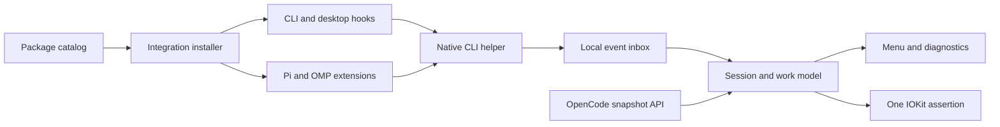

# AwakeLite architecture

Status: Stage 1 core (activity model and local event store) implemented in `Sources/Core/`; all other modules remain proposed. Requirements are in [SPEC.md](SPEC.md). Verification status lives in [STATE.md](STATE.md). Source research is in [HARNESS_RESEARCH.md](HARNESS_RESEARCH.md).

## User flow

The user opens the catalog, installs support for one family, and completes any hook-trust steps in that harness. An available local source then reports work state. AwakeLite combines states and owns one sleep assertion. Removing a package stops its contribution and removes only app-owned connections. The model accepts events only from enabled packages whose activation generation matches.

When connecting to an already running agent, use a snapshot only if an authoritative API exists. Otherwise, explain that a new request is needed. An open program alone never becomes Working.

## Selected structure

The menu-bar app owns the activity model, aggregation, and IOKit. The native CLI helper accepts and validates events. It neither holds an assertion nor stays alive as a background service.



This structure needs no network service, separate daemon, or remote marketplace. The OpenCode connection is a client of an existing local service, not a new server.

## Alternatives considered

Two independent candidate architectures were compared and reviewed before implementation.

| Option | Benefits | Costs | Decision |
| --- | --- | --- | --- |
| Independent event files and an app-owned model | Events survive app downtime; the helper needs no running receiver; no extra daemon | Requires queue bounds, crash-safe checkpoints, and gap handling | Selected base |
| Unix socket with one helper service | Centralized writes and acknowledgments | Adds service lifecycle, reconnect, and storage during outages | Excluded from the first version |
| One mutable JSON file for all helpers | Few files | Concurrent writes can lose updates and require shared synchronization | Rejected |
| Process presence or CPU usage | Easy connection | Cannot distinguish work from an open conversation | Rejected as automatic activity evidence |

Keep short helper operations and an explicit message format from the socket candidate. Arrival order in a socket or file does not prove causal order inside a harness.

## Module ownership

The following groups define ownership. Activity and the local event store are implemented in `Sources/Core/`; the remaining new source files and adapter tests do not exist yet.

| Module | Owns | Must not own |
| --- | --- | --- |
| App and views | MenuBarExtra, integration window, error presentation | Vendor payload parsing or causal-order decisions |
| Activity (`Sources/Core/Activity.swift`) | Work identity, transitions, deduplication, snapshots, aggregate decision | IOKit calls or harness configuration changes |
| Local event store (`Sources/Core/LocalEventStore.swift`) | Inbox, checkpoints, recovery, limits, safe file access | Declaring work complete because a file is old |
| Native helper | Bounded hook parsing and normalized event writes | Raw payload persistence, GUI startup, or inference |
| Integrations | Catalog, compatibility targets, previews, install and removal | Declaring a mode verified because its executable exists |
| Adapters | Vendor events, source-specific limitations, snapshot APIs | Guessing missing data or writing directly to IOKit |
| Power | One assertion and actual acquisition/release results | Process polling, pmset changes, or lid control |

Retain the existing app entry point, controller, and login-item code where appropriate. Keep Activity and the event store in the `Sources/Core/` group; add compact source groups for Integrations and Adapters, plus a separate helper entry point. [AGENTS.md](AGENTS.md) maps existing files and proposed destinations. These groups are responsibilities, not a requirement for separate frameworks or one file per type.

`ProcessScanner` must stop determining sleep policy. Any owner-identity check is separate from activity detection. Exact new file boundaries can be refined during an approved implementation.

## Data model

| Entity | Main fields | Invariant |
| --- | --- | --- |
| Integration package | Family, package version, assets, install steps, compatibility targets | One catalog drives the UI, installer, and fixtures |
| Compatibility target | CLI or desktop, harness version, observation capabilities, verification level | Verification of one target does not transfer to another |
| Owner identity | PID, start time, UID, OS boot identity, instance identity | A PID alone is insufficient |
| Session identity | Family, instance, opaque session ID | Identical strings from different sources do not merge sessions |
| Work identity | Session, generation, child or background-work ID | Old completion cannot close new work |
| Activity event | Schema version, event ID, source, activation generation, target, work, transition, available causal data | Fields without a reliable source remain unknown |
| Session state | Observed work, waits, terminal facts, observation completeness | Waiting in one work item does not cancel another |
| Install receipt | Package, activation generation, owned entries, hashes, operation stage | Removal is limited to app-owned changes |

Owner identity names the observed agent instance, not the short-lived hook helper process; adapters must derive a stable identity for that instance and change it on restart or PID reuse.

Normalized transitions cover start, human wait, resume, completion, error, cancellation, child-work start and end, snapshot, observation loss, work-scoped heartbeat, and owner termination. A heartbeat confirms observer liveness for one work item. It does not establish work state and provides no session-level liveness. Owner termination retires only that owner's work after identity verification.

Derive the sleep decision from the model instead of storing a second independent decision flag. User pause suppresses the system effect without changing observed work.

## Event order and uncertainty

Stale updates lose: an event older than the stored record for that work is rejected. Ownership is positional: the owner instance must equal the session instance, and a conflicting snapshot owner marks the record uncertain rather than transferring it. Events dated more than 300 s in the future are rejected at ingest with a gap, using event time or inbox file time as the gap timestamp.

Snapshots carry a completeness flag. Only a complete snapshot is authoritative for its scope: omitted active work ends. An incomplete snapshot marks omitted work uncertain. A snapshot older than a record or a covering gap neither ends work nor clears that gap. Oversize snapshots that exceed the work bound are rejected with a capacity gap, which conservatively marks affected work uncertain.

## Storage without an unbounded journal

A private user directory contains installed package resources and receipts, independent event files, a model checkpoint, and a short installation-operation journal. Restrict access to the current user. Never use unchecked identifiers as path components.

Bound the inbox, event size, work count, and retained terminal facts. On overflow, persist an observation-gap marker scoped to the affected source, instance, and known sessions; rejection and overflow gaps are instance-scoped, observer-loss gaps stay session-scoped. Gap storage has an absolute bound: collapse the densest scope first, then merge the two oldest. Do not claim confirmed idle until a complete authoritative snapshot covers that scope, or all affected work and owners are confirmed terminated. An unrelated new task cannot clear the uncertainty. Never delete old events merely because they appear unnecessary.

Checkpoint envelope: the checkpoint file stores a versioned `{schema, model}` envelope with strict required keys. Corrupt, oversize, symlink, or unsupported-schema checkpoints refuse to load rather than starting idle. One process serializes reconcile with an exclusive lock on `root/.lock`; the checkpoint is written with full fsync plus atomic rename.

Inbox writes use canonical identifiers and bounded payloads, with link-based exclusive file creation so concurrent writers cannot overwrite each other. Rejected files quarantine without overwriting. Save before move: processed inbox files are deleted and rejected files quarantined only after the checkpoint is saved, so a crash replays rather than loses facts.

A directory watcher requests inbox reconciliation. The app also reads the inbox at startup and periodically reconciles the inbox and owners of enabled integrations. This periodic pass must find events even when every watcher notification is lost and the owner remains alive. With no integrations enabled, do not run periodic inbox polling. File notifications alone are insufficient.

## Packages and connections

Seven bundled manifests describe trusted operations for known adapters. Installation copies or registers resources only for the selected family. Uninstalled packages create no hooks, timers, or connections.

| Family | Preferred mechanism | Separate verification needed |
| --- | --- | --- |
| Claude Code | User-level lifecycle hooks | Desktop Code, waits, errors, and Stop rejected by another hook |
| Codex | User-level hooks; snapshots from an accessible app-server if needed | Hook trust, normal desktop chats, local versus cloud orchestration |
| Cursor | Native Agent hooks | Cancellation, automatic continuation, background subagents |
| Antigravity | Hooks that account for fullyIdle | Exact CLI and desktop versions, background work, human waits |
| Pi | In-process extension | Reload, session switch, cancellation, generation IDs |
| OMP | Separate in-process extension | Auto-retry, continuation queues, background work |
| OpenCode | Native read-only connector to the existing service | Version, identity, execution details, permissions, forms |

Vendor event names and paths belong to a versioned adapter, not the shared core. Verify them against the owning source before implementation.

OpenCode needs an additional check: presence in `/api/session/active` is insufficient evidence of work. Read execution details and human waits. Use authorization only against the verified local endpoint. Do not restart the service to connect.

## Installation and removal

Create a preview and read current configuration before a change. Structurally add only owned entries with a stable marker. Reject unsupported formats, symlinks, conflicts, and stale previews without losing unrelated data.

Installation stages are prepared, applying, committed, and recovery-required. A receipt records ownership and completed changes. Rollback checks expected hashes so it cannot overwrite later user edits.

A package can connect several compatibility targets without duplicating shared hooks. Each installation receives a new activation generation, recorded in its receipt and installed command or extension. An old observer cannot acquire the new generation by reading the current receipt when it emits an event. Removing support excludes the package from the model. Ignore old-hook events even after reinstall with a different generation.

Support non-default configuration roots, profiles, and XDG locations explicitly, or report the limitation. Do not silently write into an unused default profile.

Do not bypass Codex hook trust or workspace policy. The hook helper must not change permission decisions, continue tasks, or add model context. Its output must be inert according to the specific harness contract.

## Catalog, manifests, and installer contracts

Stage 2 owns one catalog, one install model, and one recovery path. The types below are design contracts for that unit; they do not exist yet. Vendor paths and vendor event names stay in adapter sources, never in these shared types.

### App-owned storage layout

Everything the app owns lives under one root:

```
~/Library/Application Support/AwakeLite/
├── inbox/                       # Stage 1: immutable normalized event files
├── rejected/                    # Stage 1: quarantined event files
├── checkpoint.json              # Stage 1: model checkpoint envelope
├── .lock                        # Stage 1: single-writer lock
├── packages/<family>/           # installed resources copied from the bundle
├── receipts/<family>.json       # one receipt per installed package
└── journal/<operation-id>.json  # one in-flight installation operation
```

Directories are created with mode 0700 and files with 0600. `<family>` and `<operation-id>` are canonical app-owned identifiers; a raw vendor identifier is never used as a path component. `<operation-id>` is a random identifier with a monotonic component, so a journal file name cannot be predicted or reused.

The package directory holds a copy of the bundled resources, so an app update cannot change installed support underneath a running harness. Removal deletes a package directory only when its receipt says the app created it.

### Package manifest (bundled, trusted, schema 1)

`Resources/Integrations/<family>/manifest.json` is trusted input shipped inside the app. It is declarative: it contains no shell command, no network address, and no executable code.

| Field | Meaning |
| --- | --- |
| `schema` | Exactly `1`. Any other value is refused. |
| `family` | Canonical family identifier, matching the containing directory. |
| `displayName` | Card title. |
| `packageVersion` | Version of this bundled resource set, independent of the harness version. |
| `targets[]` | `id`, `mode` (`cli` or `desktop`), `capabilities`, `verificationLevel` (`unverified`, `fixture`, `live`). |
| `assets[]` | `source` inside the bundle and `destination` relative to the package root. |
| `steps[]` | Declarative configuration steps, described below. |
| `requiresRestart` | Whether the harness must restart before events can arrive. |
| `requiresHookTrust` | Whether the harness requires a user trust action. |
| `notes` | Limitations shown in the preview. |

Each `steps[]` entry has `kind` (`hookConfig`, `pluginFile`, `extensionFile`, `commandWrapper`), `target` (a compatibility target id from `targets[]`), `format` (`json`, `toml`, `yaml`, `text`, `directory`), `ownedEntries[]` with stable markers, and a `configRoot` selector. The loader refuses unknown `kind` or `format`, unknown targets, duplicate markers, absolute or escaping paths, and executable or network fields. A manifest therefore cannot express anything the installer is unable to undo entry by entry.

`verificationLevel` is data, never inference: discovering an executable, an app bundle, or a running process leaves the level unchanged. Only a fixture or a recorded live check raises it.

### Install receipt (schema 1)

`receipts/<family>.json` records ownership and lifecycle only:

| Field | Meaning |
| --- | --- |
| `schema` | Exactly `1`. |
| `family` | Family identifier. |
| `packageVersion` | Version that produced the installed entries. |
| `activationGeneration` | `UInt64`, new for every install and reinstall. |
| `installedAt` | Timestamp of the commit. |
| `stage` | `prepared`, `applying`, `committed`, or `recoveryRequired`. |
| `entries[]` | `target`, `path`, `format`, `marker`, `expectedHash` for each owned entry. |
| `previousGeneration` | Optional; the generation this install replaced. |

A receipt contains no prompts, responses, tool arguments, payloads, or credentials. `entries[]` is the complete removal set: an entry not listed can never be touched.

### Operation journal (schema 1)

`journal/<operation-id>.json` exists only while an operation is in flight or unresolved:

| Field | Meaning |
| --- | --- |
| `schema` | Exactly `1`. |
| `operationId` | Matches the file name. |
| `family` | Family being changed. |
| `action` | `install` or `remove`. |
| `stage` | Current stage, shared with the receipt vocabulary. |
| `startedAt` | Operation start. |
| `steps[]` | `target`, `path`, `beforeHash`, `afterHash`, and an optional `backupPath`. |
| `createdPaths[]` | Paths the operation created and must delete on rollback. |

Recovery runs at app start and before any new operation. It replays a journal forward when the recorded work is complete and rolls back to the prepared state otherwise. Rollback refuses to overwrite a file whose current hash differs from the step's `afterHash`, so a user edit made during or after the operation is never replaced with an older copy; the operation reports a recoverable conflict instead and stays at `recoveryRequired` until a later operation resolves it.

### Module and API boundaries

| Module | Public surface | Boundary |
| --- | --- | --- |
| `Sources/Integrations.swift` | `Catalog`, `PackageManifest`, `InstallPreview`, `InstallReceipt`, `OperationJournal`, `Installer` with `preview(family:configRoot:)`, `apply(preview:)`, `remove(family:)`, `recoverPending()` | Owns catalog loading, validation, config edits, receipts, and recovery. Never parses vendor payloads and never holds power policy. |
| `Sources/IntegrationsView.swift` | Catalog cards, preview sheet, install/remove/check actions, status and required-action text | Presents installer state and sends user intent. No file edits and no generated configuration. |
| `Sources/HookNormalizer.swift` | Allowlist parsing of a hook payload into `ActivityEvent` | Drops unknown fields; never persists a raw payload. |
| `Helper/main.swift` | Short-lived ingestion executable invoked by hooks | Writes one immutable event file per invocation and exits. Never holds power policy, never stays resident, never reads the checkpoint. |
| Adapter sources per family | Vendor paths, event names, snapshot semantics | Keep vendor contracts out of the shared core. |

`Catalog` resolves target availability without treating presence as verification. `InstallPreview` carries the family, generation it would create, config root, resolved target list, exact paths, owned entries, conflicts found, and the warnings that the confirmation sheet must display. `apply(preview:)` refuses a preview whose inputs changed since it was produced, so a stale confirmation cannot overwrite an intervening edit.

### Activation-generation handoff

`ActivityModel.activate(family:generation:)` is called at app startup from committed receipts, and `deactivate(family:)` from removal. Each install and reinstall issues a new generation recorded in the receipt and in the installed command, plugin, or extension; the installed artifact carries the generation it was installed with, and an event carrying any other generation is rejected by the existing core. A late event from a hook that was running during removal therefore cannot restore its contribution, including after a later reinstall.

The model is not wired to power policy in Stage 2. Activation exists so the generation rule can be proven before any assertion is acquired.

### Config-root rules

- The default root is the user-level location; a step may name an explicit override for a profile, XDG path, or project-scoped configuration.
- A step never guesses among several candidate roots. If the intended root is not explicitly identified, the installer reports the limitation instead of writing to an unused default profile and implying success.
- Every path the installer writes lies inside the previewed root or the app support root. Anything else fails validation.
- Read current content, structurally add or remove only owned entries, and preserve foreign settings, hooks, plugins, credentials, and formatting intent.
- Unsupported formats, symlink targets, and conflicting existing entries fail with an explanation rather than replacing a file.

### Stage 2 test matrix

All checks run against a temporary home and configuration root; no real user settings are read or written.

1. Fresh install for each of the seven families.
2. Repeated install is idempotent and creates no duplicate entry.
3. Install beside foreign hooks and plugins preserves them.
4. Unsupported format or a conflicting entry fails without replacing the file.
5. A symlink target is refused.
6. A stale preview is refused.
7. Interruption after each journal step; recovery reaches committed or prepared on the next start.
8. Rollback over a user-edited file is refused and reported as recoverable.
9. Removal preserves foreign entries.
10. Removal or reinstall rejects old-generation events.
11. Receipts and journals contain no conversation data (A15).
12. No observer runs for an inactive package (A01).

## Checks before adapter implementation

First prove the core with fixtures for two parallel sessions, late completion, a waiting parent with a working child, an event gap, PID reuse, and restart.

Then verify installation in an isolated home directory with unrelated hooks, failures, non-default paths, and interruption during changes. Connect available real products only afterward. Fixture success does not raise live compatibility status.

## Approval record and remaining first-phase checks

Approved on 2026-11-01 for Stage 1: native app-owned core, local packages, independent events, separate compatibility targets, and uncertainty rules.

Remaining first-phase checks: bounded checkpoint prototype verification, event completeness in installed harnesses, and actual observation of local Codex desktop tasks. If a source lacks the required guarantees, revise that adapter or its status rather than weaken the shared model.
